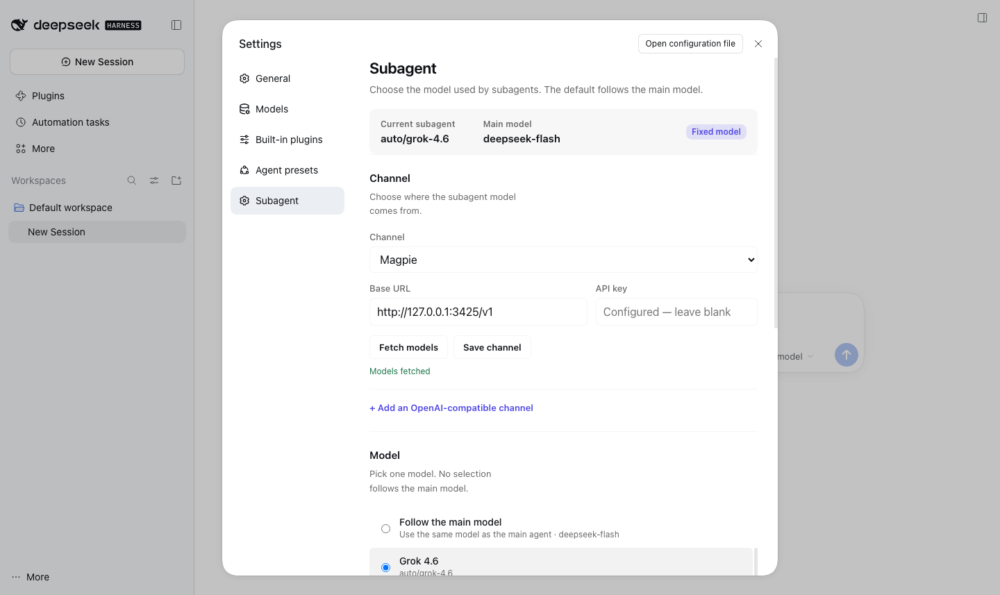
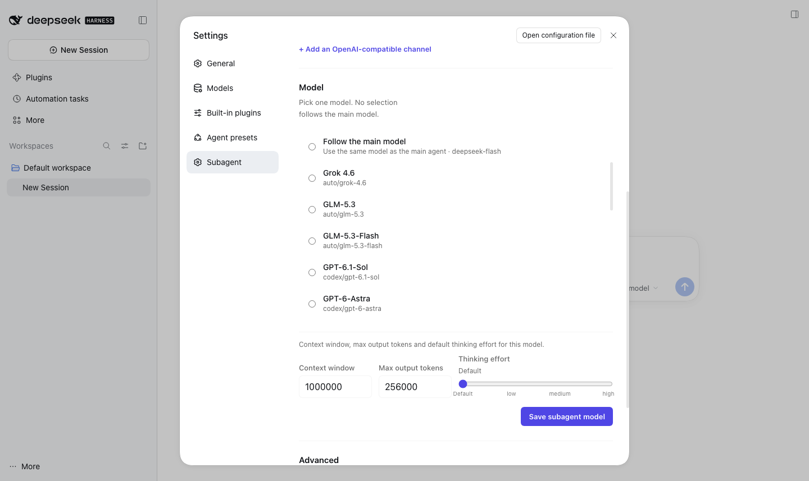
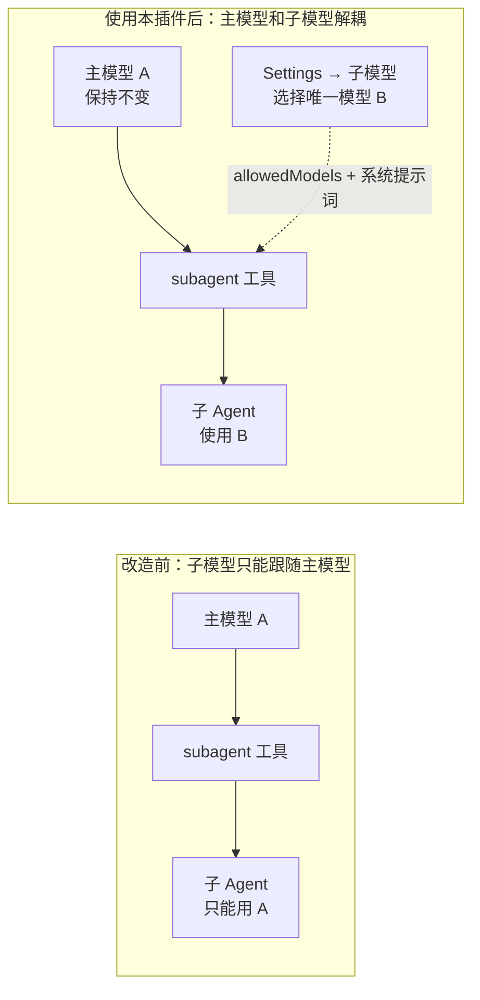
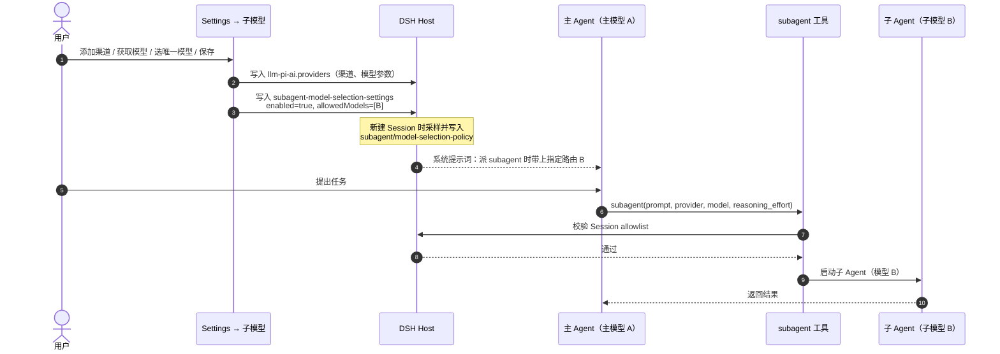

# dsh-subagent-toolkit

**给 DeepSeek Harness 的子代理（subagent）单独指定模型。**

主模型继续用你惯用的模型，子代理可以固定走另一个第三方模型 —— 不改 DSH 源码，不替换 DeepSeek Account，也不影响主对话。





> 适用 DSH `0.2.1-rc.5`（`engines.dsh: >=0.2.1-rc.5 <0.3.0`）

## 为什么需要它

DeepSeek Harness 有两条模型链路：

| 链路 | 用途 | 由什么决定 |
| --- | --- | --- |
| 主模型 | 主对话、主 Agent | `agent-default-model` |
| 子模型 | `subagent` 创建的子 Agent | `tool-subagent` 的默认值 / 父 Agent 路由；可选 `subagent-model-selection-settings` |

原生逻辑有两个现实限制：

1. **子模型默认继承主模型。** `subagent` 未显式指定 `provider/model` 时，子 Agent 走父 Agent 的同一路由。接入第三方模型时，常见做法是直接替换主模型 —— 主模型换成第三方，子代理也被一起绑走，无法做到“主模型 A + 子模型 B”。
2. **原生的模型选择是“授权名单”，不是“固定默认值”。** `subagent-model-selection-settings` 默认关闭；即使打开，也只是允许主 Agent 在每个 `subagent` 调用里从名单中挑一个模型。原生的“子智能体”设置页只能从当前模型目录里勾选授权，不能在同一页添加 OpenAI 兼容渠道、拉取模型或设置模型参数，也没有“固定子模型”这一项。主 Agent 不主动传参时，子代理还是回到主模型。

所以，直接接第三方模型时，子模型机制相当于被写死在“跟随主模型”上。本插件就是为补这一层灵活度而做的。

## 它做了什么

- **Settings → 子模型 页面**：添加 OpenAI 兼容渠道（Base URL、API Key）、获取模型列表、只选一个子模型；也可以保留“跟随主模型”。
- **写入官方设置**：保存为 `subagent-model-selection-settings = { enabled: true, allowedModels: [{ provider, model }] }`，并同步写入 `llm-pi-ai.providers` 的渠道/模型参数（上下文窗口、最大输出、思考强度）。
- **系统提示词引导**：当允许名单恰好只有一个路由时，向主 Agent 注入一条提醒：派 `subagent` 时显式带上 `provider`、`model` 和 `reasoning_effort`。这样“固定子模型”在新会话里真正生效，而不只是写在配置里。
- **可选的 `subagent_pi`**：用官方 Pi CLI 一次性进程执行子任务，完全独立于 DSH 的 in-process 子 Agent；不会加载 PI Desktop 的 Maker，也不会触发 `codex exec`。

不改 DSH 内核，不替换 `deepseek-account`；使用的是 DSH 官方的 bundle / 配置扩展机制。原生的 **Plugins → Subagent** 页（递归深度、并发、模型授权）仍然可用，两者共存。

## 工作机制

### 改造前后



### 一次委派的完整流程



### 两个半边

| 文件 | 运行位置 | 作用 |
| --- | --- | --- |
| `client.js` | 浏览器（DSH Web GUI） | Settings → 子模型 页面：渠道、模型目录、唯一子模型、Pi CLI 高级项；通过 `configForms` 写官方配置命名空间 |
| `index.js` | Host | 注册 `pi-cli` 子代理提供方（`subagent_pi`）；读取 `subagent-model-selection-settings`，在恰好一个路由时注入系统提示词 |
| `cordis.patch.yml` | Host 启动层 | bundle patch：插入 `subagent-pi` 和 `tool-subagent-pi` 两个条目 |
| `package.json` | — | DSH bundle 清单，声明 `engines.dsh` 和 client 注入 |

DSH 侧的两个关键点（也是使用时要记住的）：

- `subagent-model-selection-settings` 是 **Host 在 Agent 创建时采样** 的设置。保存后只对 **新会话** 生效；老会话不会追溯。
- `subagent` 工具只有在 Session 存在 allowlist 且调用显式传 `provider + model` 时才会切换子路由；未传参时仍按 `tool-subagent.agentOptions` / 父 Agent 路由走。

## 安装

本地路径：

```sh
dsh plugin --profile desktop add /absolute/path/to/dsh-subagent-toolkit
```

或使用目录里已打好的 tgz：

```sh
dsh plugin --profile desktop add ./dist/dsh-subagent-toolkit-0.2.0.tgz
```

发布到 npm 后：

```sh
dsh plugin --profile desktop add dsh-subagent-toolkit
```

安装后打开 **Settings → 子模型**。

## 使用

1. **选择渠道**：用已经存在的渠道，或点“添加 OpenAI 兼容渠道”，填 Base URL 和 API Key。
2. **获取模型**：点“获取模型”，从返回的模型列表里选一个。
3. **只选一个模型并保存**：保存后会写入 `enabled=true` + `allowedModels=[该路由]`；想恢复“跟随主模型”就不选模型直接保存。
4. **新开会话**：设置只在 Agent 创建时采样，保存后请新开会话（或重启 DSH）。
5. **可选 Pi CLI**：在页面底部的 Advanced 区域配置 `subagent_pi`；`pi` 需在 PATH 中，或填写绝对路径。

## 版本、优先级与风险

### 配置优先级（谁覆盖谁）

DSH 的加载顺序是：

1. 内置 bundle 层（base / web-app 等）
2. 插件 bundle 层（按 profile `package.json` 的 `dsh.profile.bundles` 顺序，后加的在后）
3. profile 的 `cordis.patch.yml`
4. home 级 `cordis.patch.yml`（优先级最高）

也就是说：

- **插件不会比官方“优先”。** 它只在 bundle 层插入自己的两个条目（`subagent-pi`、`tool-subagent-pi`），不覆盖官方条目；设置页保存的值走第 3 层，最终以用户 profile 为准。
- **和官方设置页的关系是“同一份数据”。** 我们的页面与 DSH 官方的 Plugins → Subagent 页都编辑 `subagent-model-selection-settings`；不是谁优先级高，而是同一命名空间的值，最后保存的一方生效（页面内的 revision 校验只防同一页面的并发编辑）。
- **子代理运行时路由优先级**：`subagent` 调用显式传入的 `provider/model/reasoning_effort`（必须在 Session allowlist 中）> `tool-subagent.agentOptions` 部署默认值 > 父 Agent 的主模型。

### 兼容性

| 项目 | 要求 |
| --- | --- |
| DSH | `>=0.2.1-rc.5 <0.3.0`；在 `0.2.1-rc.5` 上验证 |
| Client | Web 平台（`dsh.client.platform: web`），即桌面 App 的 Web GUI |
| Pi CLI（可选） | `pi` 在 PATH，或在 `subagent-pi.binPath` 配绝对路径 |

### 风险提示

- **软约束，不是内核强制。** “固定子模型”依靠系统提示词提醒主 Agent 传参；模型不遵守时仍可能退回主模型路由。若需要硬默认，请同时设置 `tool-subagent.agentOptions`（并验证它与模型自选的叠加效果）。
- **只影响新会话。** `subagent-model-selection-settings` 在 Agent 创建时采样；保存后请新开会话（或重启 DSH），老会话不会更新。
- **路由失效会报错。** 删除/重命名渠道或模型后，已保存的 allowedModels 会指向不存在的路由，`subagent` 调用会失败；回设置页重新选择并保存即可。
- **升级可能失效。** 插件依赖 DSH 的扩展点：`configForms`、`settings.section`、`llm-pi-ai.providers`、`subagent-model-selection-settings`。DSH 升级到 `0.3.x` 后，bundle 可能因 `engines.dsh` 不匹配被跳过（设置页消失），或 client API 变化导致页面不可用。升级前保留旧版 `dist/*.tgz` 以便回滚；升级后先验证设置页和一次 delegation。
- **条目 id 冲突。** 插件插入的 `subagent-pi` / `tool-subagent-pi` 若与未来官方条目重名，Loader 会报重复 id；届时需要改 id 或改用官方能力。
- **Pi CLI 是外部进程。** `subagent_pi` 会执行你本机的 `pi` 二进制，不继承父会话上下文和 DSH Session 记录；只从可信来源安装。未安装 `pi` 时只有 `subagent_pi` 不可用，不影响原生 `subagent`。
- **API Key 存储。** 页面通过 DSH credential service 保存 key，设置页不回显；不要把 key 写进 README 或配置文件。

### DSH 升级后的自检

1. 打开 **Settings → 子模型**，确认能读取渠道和模型。
2. 保存一次唯一子模型，检查 `~/.dsh/profiles/desktop/cordis.patch.yml` 里的 `subagent-model-selection-settings`。
3. 新开一个会话，触发一次 `subagent`，确认子会话使用指定模型。
4. 如果页面消失或保存报错：先回滚到旧版 DSH，或禁用本插件并改用官方能力。

## 目录结构

```text
dsh-subagent-toolkit/
├── index.js              # Host 半边：subagent_pi 提供方 + 系统提示词引导
├── client.js             # 浏览器半边：Settings → 子模型 页面
├── cordis.patch.yml      # DSH bundle patch：插入 subagent-pi / tool-subagent-pi
├── package.json          # DSH bundle 清单
├── locale/               # 页面文案（en / zh）
├── docs/                 # 截图
├── dist/                 # 打包好的安装 tgz
└── market/               # DSH 插件市场索引示例
```

## 开发

修改 `index.js` / `client.js` 后，用 `npm pack` 或 `pnpm pack` 重新生成 `dist/dsh-subagent-toolkit-<version>.tgz`，再按上面的安装命令安装即可。

## License

MIT
